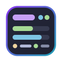
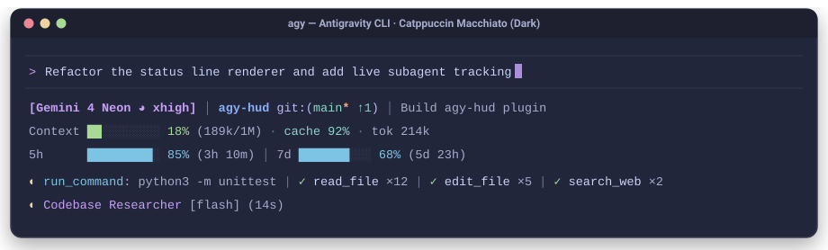

<div align="center">



# AGY HUD

**A [`claude-hud`](https://github.com/jarrodwatts/claude-hud)-inspired real-time status line plugin for Google Antigravity CLI (`agy`)**

[](LICENSE)
[](https://www.python.org/)
[](#architecture)

**English** | [简体中文](README.zh-CN.md)

<br />

<picture>
  <source media="(prefers-color-scheme: dark)" srcset="assets/preview-dark.svg" />
  <source media="(prefers-color-scheme: light)" srcset="assets/preview-light.svg" />
  
</picture>

</div>

---

## Why AGY HUD?

`agy-hud` brings the clean, airy, zero-clutter telemetry design of `claude-hud` natively to **Antigravity CLI (`agy`)**:

- **Zero external dependencies** — Pure Python 3 standard library (`>=3.9`). No `npm install`, no build step, no `jq`, works across Linux, macOS, WSL, and Windows.
- **Zero symbol collisions** — Avoids exotic glyphs that trigger CJK fallback overlapping; uses crisp `[Model ◕ xhigh]` effort dials (`○ ◔ ◑ ◕ ●`), classic `project git:(main* ↑1)`, and adaptive **10 / 6 / 4-cell** progress bars.
- **Column-aligned responsive layout** — Merges horizontally on wide terminals and gracefully stacks with **CJK-accurate vertical label alignment** on medium/narrow screens.
- **Dual color families + Auto Light/Dark** — Context bars use Green → Yellow → Red; 5h/7d Quota bars use Sapphire → Peach → Red. Automatically detects Antigravity's `colorScheme` (`Catppuccin Latte` on light, `Catppuccin Macchiato` on dark), plus **Tokyo Night**, **Nord**, **Gruvbox Dark**, and **ANSI 16-color**.
- **Live activity tracking** — Streams Antigravity's `transcript.jsonl` to show currently running tools (`◐`), completed tool counts (`✓ ×N`), and active/recent subagents.
- **Native Antigravity Plugin** — Ships with `plugin.json`, `agy-hud-setup`, and `agy-hud-configure` guided skills.

---

## Installation

### Option 1: Install as an Antigravity Plugin (Recommended)

```bash
agy plugin install https://github.com/Kiterlin/agy-hud
```

Then ask Antigravity inside `agy`:

> Set up and enable the `agy-hud` status line

Or run the one-line installer directly:

```bash
python3 ~/.gemini/config/plugins/agy-hud/bin/agy-hud.py --install
```

### Option 2: Clone from GitHub

```bash
git clone https://github.com/Kiterlin/agy-hud.git
python3 agy-hud/bin/agy-hud.py --install
```

On Windows (PowerShell 7):

```powershell
git clone https://github.com/Kiterlin/agy-hud.git
python agy-hud\bin\agy-hud.py --install
```

> **Note:** Your previous `statusLine` block in `~/.gemini/antigravity-cli/settings.json` is automatically backed up to `agy-hud.backup.json` and restored cleanly if you run `--uninstall`.

---

## Layout & Width Adaptation

### Wide Terminal (`≥ 112 cols`)

```text
[Gemini 4 Neon ◕ xhigh] │ agy-hud git:(main* ↑1) │ Build agy-hud plugin
Context ██░░░░░░░░ 18% (189k/1M) · cache 92% · tok 214k │ 5h █████████░ 85% (3h 10m) │ 7d ███████░░░ 68% (5d 23h)
◐ run_command: python3 -m unittest | ✓ read_file ×12 | ✓ edit_file ×5 | ✓ search_web ×2
◐ Codebase Researcher [flash] (14s)
```

### Standard Terminal (`80–111 cols`, vertically column-aligned bars)

```text
[Gemini 4 Neon ◕ xhigh] │ agy-hud git:(main* ↑1) │ Build agy-hud plugin
Context ██░░░░░░░░ 18% (189k/1M) · cache 92% · tok 214k
5h      █████████░ 85% (3h 10m) │ 7d ███████░░░ 68% (5d 23h)
◐ run_command: python3 -m unittest | ✓ read_file ×12 | ✓ edit_file ×5
```

### Narrow Terminal (`< 80 cols`, 6/4-cell bars, zero wrapping glitches)

```text
[Gemini 4 Neon ◕ xhigh] │ agy-hud git:(main*?)
Context █░░░  5% (57k/1M) · cache 90% · tok 70k
5h      ███░ 85% (3h 10m) │ 7d ███░ 68% (5d 23h)
✓ read_file ×12 | ✓ edit_file ×5
```

---

## Configuration

Use the bundled **`agy-hud-configure`** skill inside Antigravity, use CLI flags, or edit `~/.gemini/antigravity-cli/agy-hud.json` directly (changes apply immediately on the next UI refresh):

```bash
# Switch preset / theme / language / layout via CLI
python3 ~/.gemini/config/plugins/agy-hud/bin/agy-hud.py --configure \
  --preset full \
  --layout expanded \
  --theme auto \
  --language en \
  --bar-style block

# Preview across terminal widths in your terminal
python3 ~/.gemini/config/plugins/agy-hud/bin/agy-hud.py --preview

# Diagnose wiring, Python version, theme detection, and latency
python3 ~/.gemini/config/plugins/agy-hud/bin/agy-hud.py --doctor
```

### Presets

| Preset | Included Modules |
| :--- | :--- |
| `full` *(default)* | Model + effort, project + git (`* ? ↑ ↓`), title, context bar + tokens + cache hit + cumulative tokens, 5h/7d quotas, active alerts, live tools & subagents |
| `essential` | Model + effort, project + git, context bar + tokens, 5h/7d quotas, alerts, live tools & subagents |
| `minimal` | Model + effort, context bar, 5h quota bar, critical alerts |

### Full `agy-hud.json` Reference

```json
{
  "preset": "full",
  "layout": "expanded",
  "language": "en",
  "theme": "auto",
  "pathLevels": 1,
  "showSeparators": false,
  "display": {
    "showModel": true,
    "showEffort": true,
    "showProject": true,
    "showGit": true,
    "showGitAheadBehind": true,
    "showSessionTitle": true,
    "showContextBar": true,
    "showContextTokens": true,
    "showCacheHit": true,
    "showSessionTokens": true,
    "showQuota": true,
    "showQuotaBar": true,
    "showQuotaReset": true,
    "showStatusBadges": true,
    "showTools": true,
    "showAgents": true,
    "showDuration": false,
    "quotaValueMode": "remaining",
    "barStyle": "block",
    "contextWarningThreshold": 70,
    "contextCriticalThreshold": 85,
    "quotaWarningThreshold": 50,
    "quotaCriticalThreshold": 20,
    "toolsMaxVisible": 4,
    "agentsMaxVisible": 3,
    "customLine": ""
  },
  "colors": {}
}
```

### Built-in Themes

`auto` *(default: `catppuccin-latte` on light, `catppuccin-macchiato` on dark)*, `catppuccin-latte`, `catppuccin-macchiato`, `tokyo-night`, `nord`, `gruvbox-dark`, and `ansi` (16-color). Any color role (`model`, `project`, `git_wrap`, `git_branch`, `ctx_ok`, `usage_ok`, `warn`, `peach`, `crit`, `text`, `subtext`, `overlay`, `bar_empty`) can be overridden with `#RRGGBB` in `colors`.

### Languages

- `en` — English *(default)*
- `zh-Hans` — 简体中文
- `zh-Hant` — 繁體中文

---

## Architecture

```text
Antigravity CLI ──(stdin JSON)──▶ bin/agy-hud.py ──▶ stdout (ANSI HUD)
                                       │
                                       ├── reads ~/.gemini/antigravity-cli/agy-hud.json
                                       ├── reads ~/.gemini/antigravity-cli/settings.json (theme)
                                       ├── fast git status (--no-optional-locks + .git/HEAD fallback)
                                       └── tail-parses transcript.jsonl (tools & subagents)
```

## Development & Testing

```bash
# Run unit tests (zero external deps)
python3 -m unittest discover -s tests -v

# Validate Antigravity plugin manifest & skills strictly
agy plugin validate . --strict

# Test stdin rendering with sample payload
python3 bin/agy-hud.py < examples/sample-payload.json
```

## Credits & License

Inspired by [jarrodwatts/claude-hud](https://github.com/jarrodwatts/claude-hud) and the [Catppuccin](https://catppuccin.com/) color palette.

Released under the [MIT License](LICENSE).
