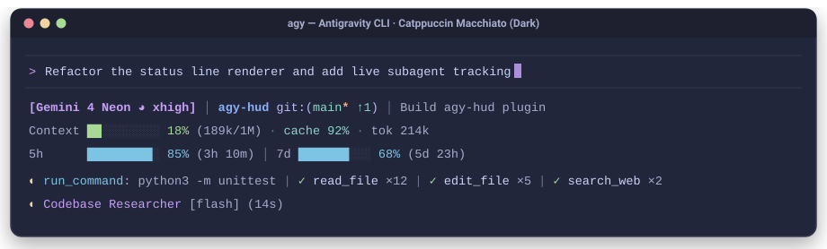

<div align="center">


# AGY HUD

**受 [`claude-hud`](https://github.com/jarrodwatts/claude-hud) 启发的 Google Antigravity CLI (`agy`) 实时 HUD 状态栏插件**

[](LICENSE)
[](https://www.python.org/)
[](#工作原理)

[English](README.md) | **简体中文**

<br />

<picture>
  <source media="(prefers-color-scheme: dark)" srcset="assets/preview-dark.svg" />
  <source media="(prefers-color-scheme: light)" srcset="assets/preview-light.svg" />
  
</picture>

</div>

---

## 核心特性

`agy-hud` 将 `claude-hud` 清爽、舒展、信息层次分明的终端 HUD 设计原生带到 **Antigravity CLI (`agy`)**：

- **纯 Python 3 零依赖**：仅使用标准库（`Python >= 3.9`），免 `npm install`、免编译、免 `jq`，跨 Linux / macOS / WSL / Windows 开箱即用。
- **拒绝图标挤压与错位**：摒弃容易触发 CJK 字体回退重叠的冷门符号，采用 `[Gemini 4 Neon ◕ xhigh]` 推理月相刻度（`○ ◔ ◑ ◕ ●`）、经典 `agy-hud git:(main* ↑1)`，以及 **10 / 6 / 4 格** 自适应进度条。
- **列对齐响应式排版**：宽屏横向合并；常规与窄屏自动拆行，并按 CJK 真实显示宽度做左侧标签补齐，让多条进度条垂直齐边、绝不乱断行。
- **双色系区分 + 明暗自动适配**：上下文采用绿→黄→红，5h/7d 配额采用青蓝→橙→红，一眼区分。默认自动检测 Antigravity 的 `colorScheme`（浅色自动 **Catppuccin Latte**，深色自动 **Catppuccin Macchiato**），同时内置 **Tokyo Night**、**Nord**、**Gruvbox Dark** 与 **ANSI 16 色**。
- **实时工具与子 Agent 活动追踪**：流式截尾读取 Antigravity 的 `transcript.jsonl`，实时展示正在运行的工具目标（`◐`）、已完成工具统计（`✓ ×N`）及活跃子 Agent 状态。
- **原生 Antigravity 插件**：内置标准 `plugin.json` 与 `agy-hud-setup` / `agy-hud-configure` 两个交互式引导技能。

---

## 快速安装

### 方式一：作为 Antigravity 插件安装（推荐）

```bash
agy plugin install https://github.com/Kiterlin/agy-hud
```

随后在 `agy` 对话框中直接说：

> 帮我安装并启用 agy-hud 状态栏

或者直接在终端执行一键安装：

```bash
python3 ~/.gemini/config/plugins/agy-hud/bin/agy-hud.py --install
```

### 方式二：Git 克隆安装

```bash
git clone https://github.com/Kiterlin/agy-hud.git
python3 agy-hud/bin/agy-hud.py --install
```

Windows（PowerShell 7）：

```powershell
git clone https://github.com/Kiterlin/agy-hud.git
python agy-hud\bin\agy-hud.py --install
```

> **安全备份**：安装时会自动把 `~/.gemini/antigravity-cli/settings.json` 中原有的 `statusLine` 配置备份到 `agy-hud.backup.json`，随时可通过 `--uninstall` 一键无损还原。

---

## 配置与预览

你可以在 `agy` 中唤醒 **`agy-hud-configure`** 技能进行交互式配置，也可以用 CLI 参数或直接编辑 `~/.gemini/antigravity-cli/agy-hud.json`（无需重启，下一次刷新立即生效）：

```bash
# 通过 CLI 快速切换预设 / 主题 / 中文标签 / 进度条样式
python3 ~/.gemini/config/plugins/agy-hud/bin/agy-hud.py --configure \
  --preset full \
  --layout expanded \
  --theme auto \
  --language zh-Hans \
  --bar-style block

# 在终端直接查看多宽度实时渲染效果
python3 ~/.gemini/config/plugins/agy-hud/bin/agy-hud.py --preview

# 环境诊断（检查配置、主题检测、渲染耗时）
python3 ~/.gemini/config/plugins/agy-hud/bin/agy-hud.py --doctor
```

### 内置预设

| 预设 | 包含模块 |
| :--- | :--- |
| `full` *(默认)* | 模型与推理档位、项目与 Git（`* ? ↑ ↓`）、会话标题、上下文进度条 + 缓存命中率 + 会话累计 Token、5h/7d 配额、按需状态徽章、实时工具与子 Agent 活动行 |
| `essential` | 模型与推理档位、项目与 Git、上下文进度条、5h/7d 配额、状态徽章、实时工具与子 Agent 活动行（隐藏标题、缓存与累计 Token） |
| `minimal` | 极简核心：模型与推理档位、上下文进度条、5h 配额条、关键预警 |

### 支持主题与语言

- **主题**：`auto`（默认，自动切换 `catppuccin-latte` / `catppuccin-macchiato`）、`catppuccin-latte`、`catppuccin-macchiato`、`tokyo-night`、`nord`、`gruvbox-dark`、`ansi`（16 色），并支持在 `colors` 中用 `#RRGGBB` 覆写任意色槽。
- **语言**：`en`（英文）、`zh-Hans`（简体中文）、`zh-Hant`（繁體中文）。

---

## 工作原理

```text
Antigravity CLI ──(stdin JSON)──▶ bin/agy-hud.py ──▶ stdout (ANSI HUD)
                                       │
                                       ├── 读取 ~/.gemini/antigravity-cli/agy-hud.json
                                       ├── 自动检测 settings.json 的 colorScheme（明/暗主题）
                                       ├── 极速 git status（--no-optional-locks + .git/HEAD 降级）
                                       └── 截尾解析 transcript.jsonl（工具调用 & 子 Agent）
```

## 本地开发与校验

```bash
# 运行零依赖单元测试
python3 -m unittest discover -s tests -v

# 用 Antigravity 官方校验器严格检查插件清单与技能
agy plugin validate . --strict

# 使用示例 JSON 测试标准输入渲染
python3 bin/agy-hud.py < examples/sample-payload.json
```

## 致谢与开源协议

设计灵感源自 [jarrodwatts/claude-hud](https://github.com/jarrodwatts/claude-hud) 与 [Catppuccin](https://catppuccin.com/) 配色方案。

基于 [MIT License](LICENSE) 开源。
